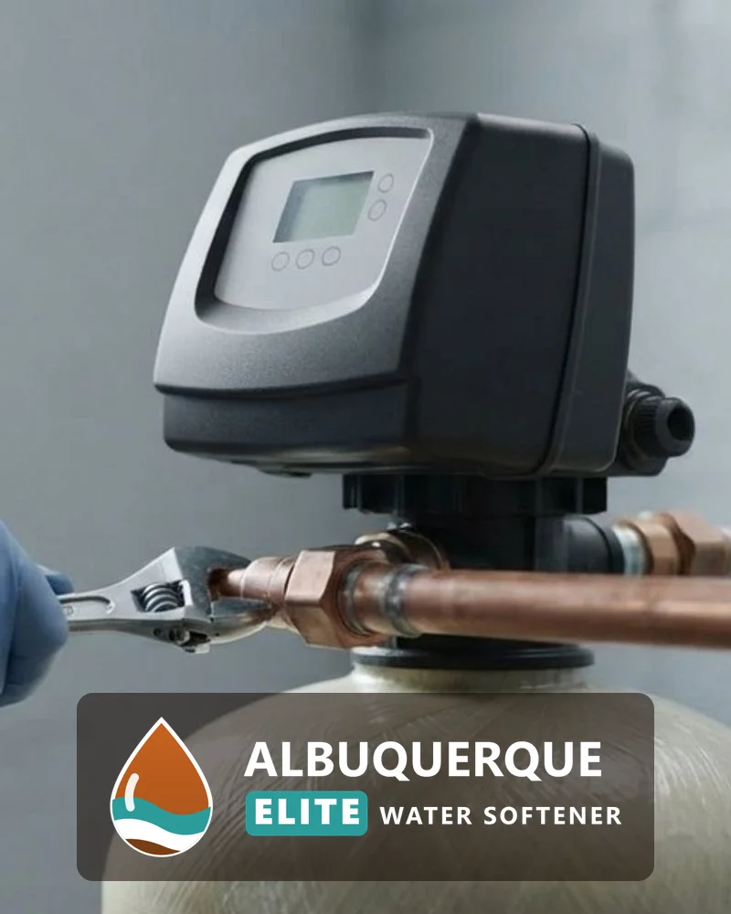

## How Does Water Softener Installation Work in Albuquerque, NM?

Every installation follows the same four steps, from the first call to the follow-up visit.

### Step 1: Free Estimate and Water Test

A technician tests your water for hardness and reviews your household size, your water use and the install location.

### Step 2: Custom System Recommendation

You receive a written recommendation with the system type, the grain capacity and an itemized price. At 8.44 gpg, a household of four using 320 gallons a day removes about 2,700 grains daily, so a 24,000-grain unit regenerates about every 9 days.

### Step 3: Professional Installation

A qualified technician installs the system, connects the drain and brine line, programs the control head and tests every tap. A standard install typically takes about 2 to 4 hours.

### Step 4: Ongoing Support and Maintenance

Salt refills, settings and a yearly inspection keep the system at capacity, and you can call with questions after the job is done.

## Frequently Asked Questions About Water Softeners in Albuquerque, NM

Most questions homeowners ask before buying fall into eight areas: water hardness, cost, system choice, timeline, water source, upkeep and where we work.

How hard is Albuquerque water?

Albuquerque water is hard. ABCWUA's 2023 water quality report put the city average hardness at 8.44 grains per gallon, about 144 mg/L, with a range of 2.09 to 11.72 grains per gallon. Hardness differs by supply mix, distribution zone and over time, so a free test at your tap gives the number that matters for sizing.

How much does water softener installation cost in Albuquerque, NM?

Installed price depends on system capacity, system type, plumbing layout and whether a drain line already exists. The free estimate gives an itemized price for your home before any work begins.

What is the best water softener for Albuquerque water?

The best system matches your household size and your test results. A salt-based softener removes hardness minerals and suits Albuquerque's hard water, and the technician sizes its capacity to your daily water use. Salt-free systems suit homeowners who prioritize low maintenance.

Salt vs. salt-free water softener: what is the difference?

A salt-based softener removes calcium and magnesium through ion exchange and needs salt refills and a drain. A salt-free system conditions the water so scale does not stick, adds no sodium, and leaves the minerals in the water. Salt-based units deliver true softening, while salt-free units reduce scale.

How long does water softener installation take?

Most installations finish in a single visit, typically in about 2 to 4 hours. The technician confirms the timeline at your estimate, based on plumbing access and system type.

Do I need a water softener with city water or well water in Albuquerque?

Both benefit. City water from ABCWUA blends locally pumped groundwater with treated San Juan-Chama surface water, and it still arrives hard. Private well water draws directly from an aquifer and can be harder and carry iron or other minerals. Nobody tests a private well for you, so a test shows whether a softener alone is enough.

How often does a water softener need maintenance?

Check the salt level monthly and refill when it drops below one-third full. Have a technician service the system once a year to inspect the resin bed, brine tank and valve.

What areas do you serve?

We serve Albuquerque and Bernalillo County, including Nob Hill, North Valley, Sandia Heights, Four Hills and Taylor Ranch. Sandia Heights is served by Sandia Peak Utility, not ABCWUA, so the city hardness figures on this page do not describe it.

## Our Service Areas Across Albuquerque & Bernalillo County

Albuquerque Elite Water Softener provides local water softener installation, replacement, diagnostic repairs, and whole-house filtration services throughout Albuquerque and Bernalillo County. Because municipal water characteristics and private well mineral levels vary across the region, our licensed technicians engineer systems tailored specifically to your localized water supply.

* Albuquerque Neighborhoods: Serving residential and commercial properties in Nob Hill, North Valley, Sandia Heights, Four Hills, Taylor Ranch, High Desert, and the East Mountain area.
* Utility Coverage Area: Certified installations and service for homes connected to the Albuquerque Bernalillo County Water Utility Authority (ABCWUA), independent utility zones like Sandia Peak Utility, and rural private wells.
* On-Site Location Verification: Because water hardness profiles differ by neighborhood and water source, Albuquerque Elite Water Softener conducts free on-site water testing to confirm precise hardness levels and verify service availability directly at your address.
