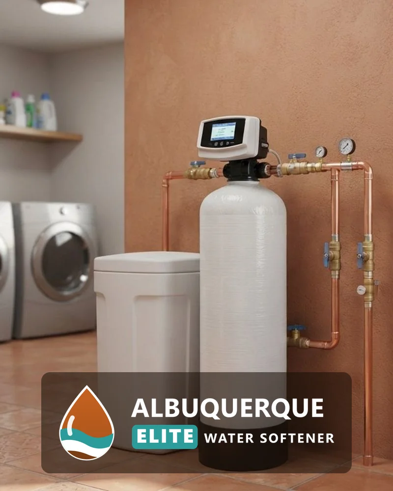
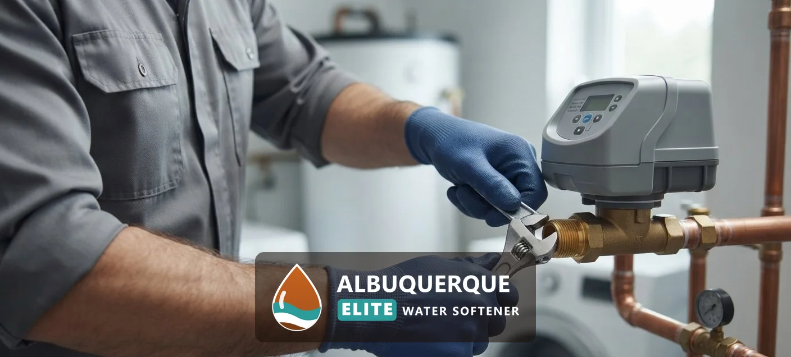
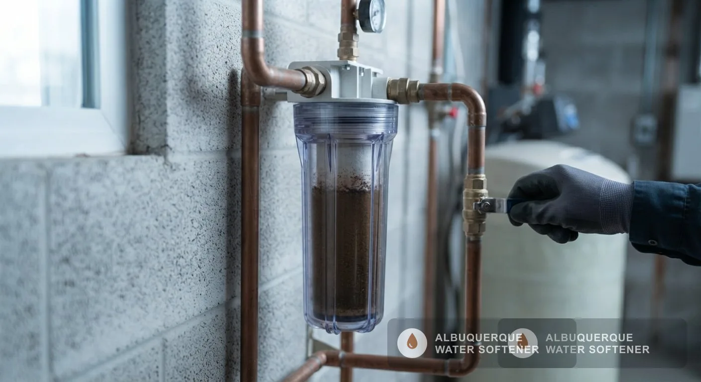
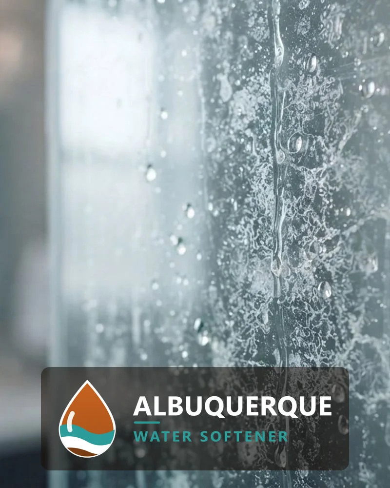

## Why Are We the Best Water Softener Installation Company in Albuquerque, NM?

Homeowners choose a water softener company on five things: who does the work, how the system is backed, how fast help arrives, whether the installer knows local water, and what the estimate includes. Use these six checks with any company, this one included.

- **Licence:** Ask any installer for the licence number New Mexico requires for the work and for proof of insurance before work starts.
- **Warranty:** The estimate states the warranty on the equipment and on the labor. Read it before you approve the work.
- **Sizing by test:** A correct system size comes from a hardness test and your household's daily water use, not from a standard package.
- **Local water knowledge:** ABCWUA blends locally pumped groundwater with treated San Juan-Chama surface water, and its 2023 report gave a city hardness range of 2.09 to 11.72 grains per gallon, so the number changes with the address.
- **Scheduling:** Ask how quickly the installer can fit your job in. Same-day service depends on technician availability.
- **Itemized estimate:** The estimate lists the unit, the plumbing work and the labor, so you see what is included before work starts.

[Request Your Free Estimate](#estimate)

## What Water Softener Services Are Available in Albuquerque, NM?

Albuquerque Elite Water Softener covers six core services, from first installation to long-term maintenance, and adds specialty systems for larger homes, businesses and wells.

### Water Softener Installation

Installation connects a new softener to your home's main water line so every faucet, shower and appliance receives softened water. The unit is sized to your household and water use, fitted with a bypass valve, connected to a drain and brine line, programmed and tested at every tap before the technician leaves.

### Water Softener Replacement

Replacement removes an old or failing softener and installs a new, correctly sized unit on the existing plumbing. It covers full system replacement, resin bed replacement and upgrades for systems that no longer soften, leak, or cost more to repair than they are worth.

### Salt-Free Water Softener Systems

A salt-free system conditions hard water so scale no longer clings to pipes and fixtures. It does not remove calcium and magnesium, needs no salt and no drain line, and fits homeowners who want lower maintenance over full softening.

### Water Softener Repair & Service

Repair and service restores softeners that stop regenerating, leave hard water, run out of salt too fast or leak at the control head. Routine service includes resin and brine tank checks, cleaning, salt refills and valve testing.

### Whole House Water Filtration

Whole house filtration treats water where it enters the home, reducing chlorine taste and sediment before it reaches every tap. It pairs with a softener because filtration and softening solve different problems.

### Water Quality Testing

A water quality test measures hardness, iron, pH, total dissolved solids and other values that decide which system fits. It is the first step of every recommendation.

Dual tank and commercial water softeners, water conditioners, reverse osmosis and UV purification, drinking water systems, well water treatment and contaminant removal filters are also available.

## Why Is Albuquerque Water So Hard?

Albuquerque water is hard because of the rock and sediment the water moves through. According to a 1988 U.S. Geological Survey report by Scott K. Anderholm, titled “Ground-Water Geochemistry of the Albuquerque-Belen Basin, Central New Mexico,” the chemistry of the water flowing into the basin's principal aquifer, the Santa Fe Group sediments, has the largest effect on the water quality found in different parts of the basin. The same report found that calcium and bicarbonate are the dominant ions in ground water on the eastern side of the basin, while in a large area west of Albuquerque sodium dominates, probably because calcium and magnesium exchange for sodium.

### Where Does Albuquerque Water Come From?

According to ABCWUA's 2025 water quality report, customers rely on locally pumped groundwater plus surface water imported from the Colorado River basin through the San Juan-Chama Project. ABCWUA says treated surface water and groundwater from both sides of the river have been blended and served throughout its system since December 2008.

### Why Does Rock and Sediment Make Water Hard?

Water that has moved through rock and sediment picks up dissolved calcium and magnesium, and those two minerals define hardness. ABCWUA's 2023 report lists a city average of 48.64 ppm calcium and 5.55 ppm magnesium.

### How Is Water Hardness Measured?

Hardness is measured in milligrams per liter (mg/L) or grains per gallon (gpg), where 1 gpg equals about 17.1 mg/L. The U.S. Geological Survey rates water under 60 mg/L as soft, 61 to 120 mg/L as moderately hard, 121 to 180 mg/L as hard and anything over 180 mg/L as very hard.

### How Hard Is Albuquerque Water?

ABCWUA's 2023 water quality report put the city average hardness at 8.44 grains per gallon, about 144 mg/L, with a range of 2.09 to 11.72 grains per gallon, which places the average in the hard range on the U.S. Geological Survey scale. ABCWUA's own FAQ says that depending on the sources and blend, the hardness ranges from moderately hard to hard.

### What Does ABCWUA's Water Quality Report Show?

ABCWUA's 2023 distribution monitoring measured free chlorine at a city average of 0.9 mg/L and total dissolved solids at a city average of 291 ppm, and its 2025 report says it collects and tests more than 5,500 water samples a year. Hardness itself is a household problem: scale narrows pipes, coats heating elements and spots glass.

### How Do You Find Your Exact Hardness?

A free water test shows the exact reading at your tap, because the supply blend and home plumbing both move the number.

