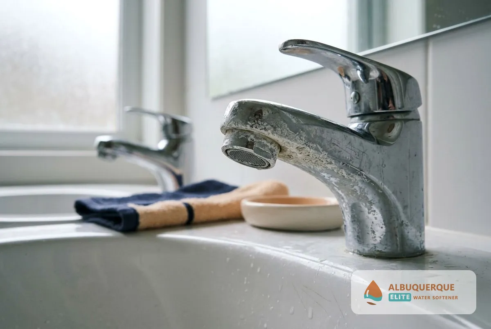
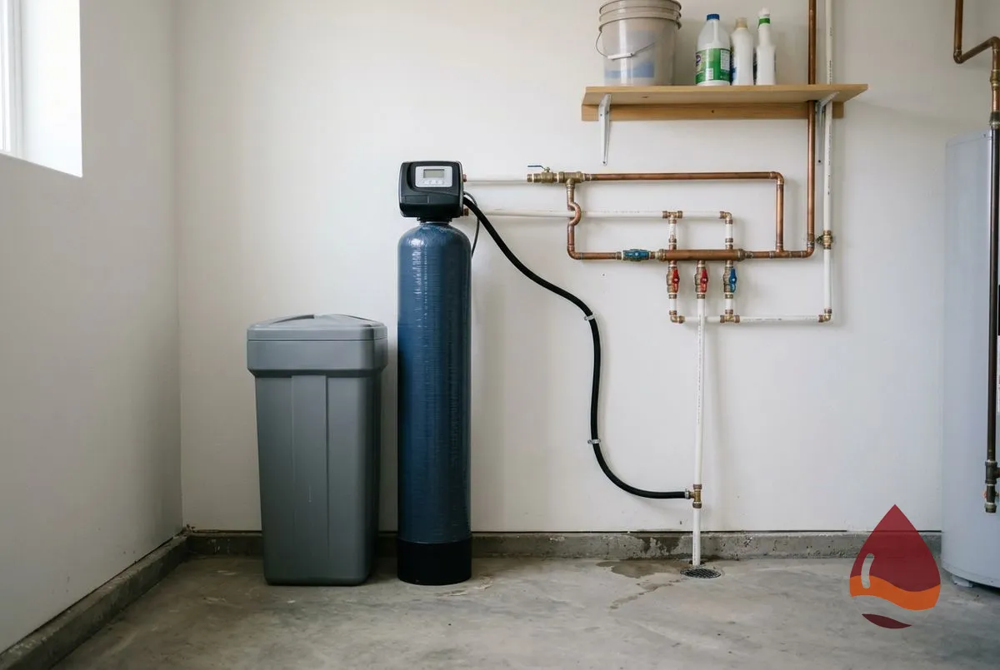
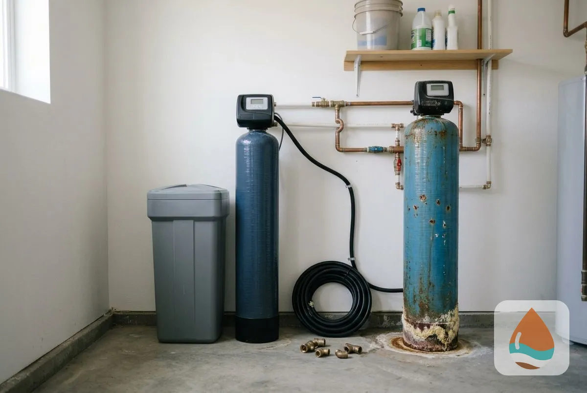
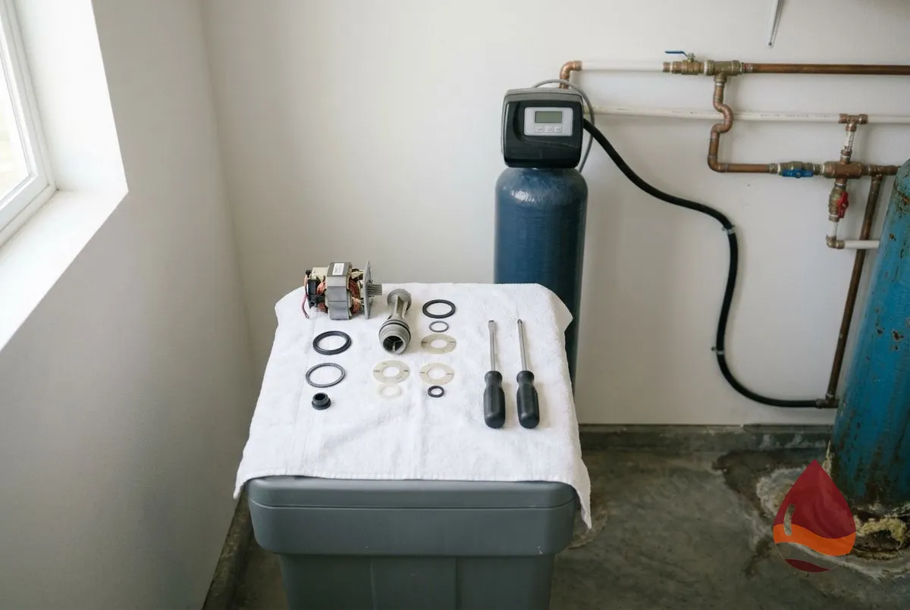
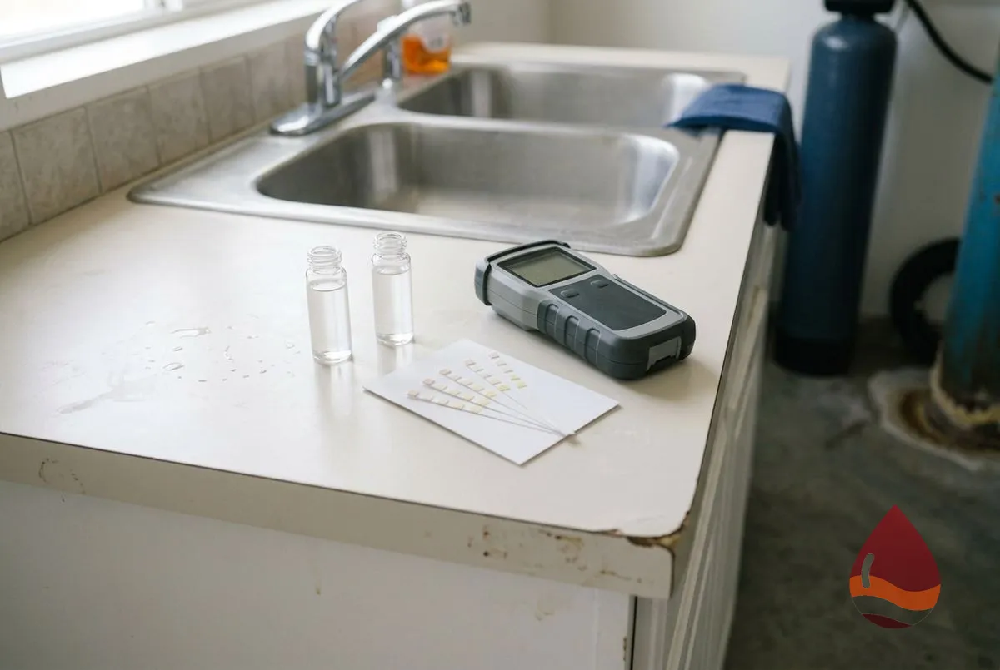
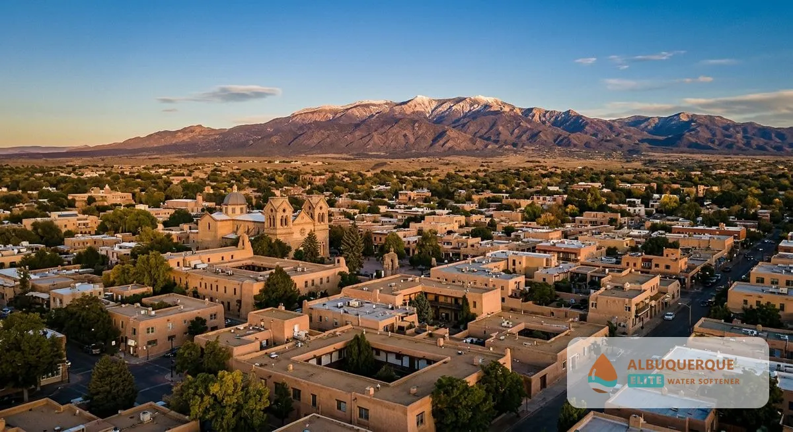
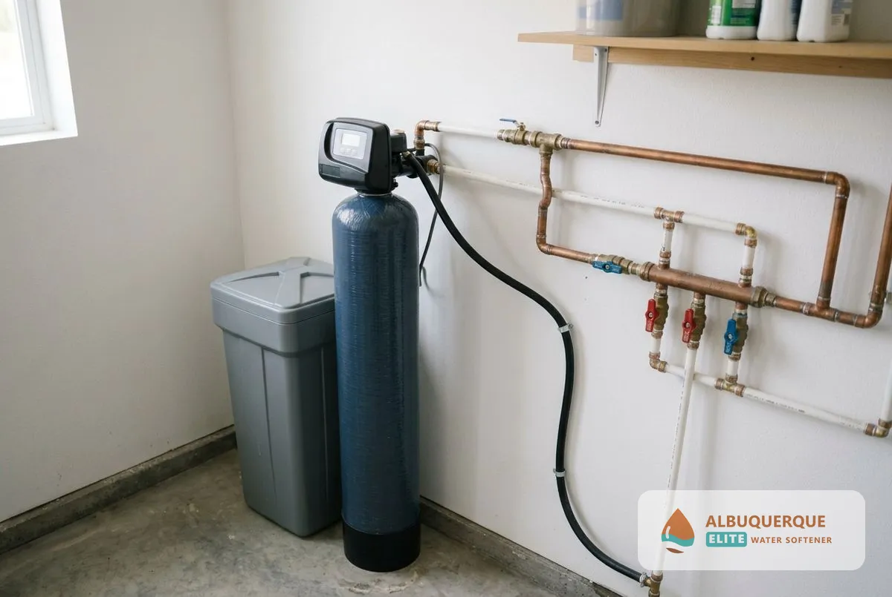
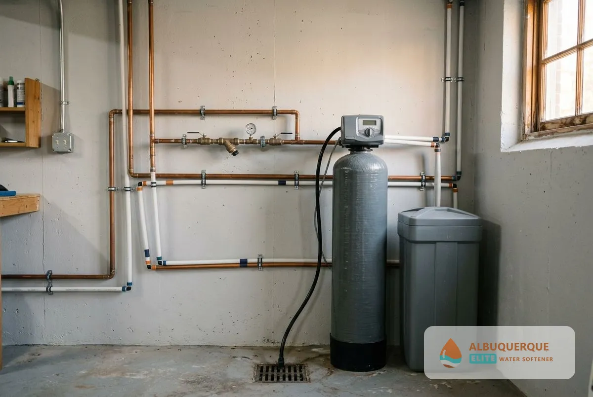

Albuquerque Elite Water Softener provides water softener installation, replacement, repair and maintenance. If you live in Santa Fe, NM, contact us to confirm service availability and discuss the right solution for your home's water.

<a class="btn btn-primary" style="color:#ffffff;" href="/#estimate">Request a Free Estimate</a>
<a class="btn" style="background:var(--color-primary);color:#ffffff;" href="/contact/">Call for Service</a>

## Signs Your Santa Fe Home May Need a Water Softener

Hard water affects more than the appearance of your bathroom. Over time, calcium and magnesium can contribute to scale buildup on fixtures and heating equipment.

Look for these common signs:

- White, chalky deposits on faucets and showerheads.
- Spots or mineral residue on dishes and glassware.
- Soap scum on shower doors and bathroom surfaces.
- Scale buildup around kettles and water-heating equipment.
- Water that does not lather easily with soap.

These signs can indicate hard water, but a water hardness test is the best way to confirm the problem.

## Water Softener Services in Santa Fe, NM

Whether you are considering your first water softener or need help with an existing system, the right service depends on your water quality, household usage and equipment condition.

### Water Softener Installation

A whole-house water softener connects to your home's main water supply to treat water throughout the plumbing system. System selection considers your measured water hardness, household size, daily water consumption and available installation space. A typical installation includes the softener, control valve, brine tank, bypass valve and drain connections.

Learn more about our [water softener installation services](/water-softener-installation/).

### Water Softener Replacement

An aging softener may require replacement when its tank leaks, its resin no longer performs effectively or repeated repairs become uneconomical. Before replacing the entire system, an inspection can help determine whether a repair, resin replacement or new unit offers better value.

### Water Softener Repair and Maintenance

If your softener stops producing softened water, leaks, fails to regenerate or consumes more salt than expected, the problem may involve the control valve, injector, motor, brine system or resin. Routine maintenance helps identify these issues and keep the system operating according to its manufacturer's specifications.

### Water Quality Testing

Water testing helps establish whether a softener is appropriate and how much treatment capacity your household requires. Depending on your water source and concerns, testing may include hardness, iron, pH and other relevant parameters. The results help determine whether softening alone is sufficient or additional treatment should be considered.

Contact us to discuss your water quality, equipment needs and service availability in Santa Fe. [Request a water softener estimate](#estimate).

## Understanding Water Quality in Santa Fe, NM

Santa Fe's municipal water supply comes from a combination of surface water and groundwater. The City's water system uses sources associated with the Santa Fe River, the Rio Grande, the City Well Field and the Buckman Well Field.

The City publishes annual drinking water quality reports describing its water sources and monitored contaminants. Its 2024 report states that the municipal supply met applicable federal and state drinking water standards.

However, drinking water compliance and water hardness are different measures. A water supply can meet drinking water standards while still containing calcium and magnesium that contribute to hard-water scale. For this reason, a current water hardness measurement is more useful than assuming every Santa Fe property has the same water conditions.

Three steps give you a usable answer:

1. Collect a water sample at your tap.
2. Measure the hardness.
3. Match the treatment to the result.

### How Hard Is Santa Fe Water?

Water hardness can vary depending on the supply source, water blending, and whether a property receives municipal or private-well water. Calcium and magnesium are the main minerals responsible for hardness. A test at your tap can determine the current level and help establish whether a water softener would be beneficial.

The City's 2024 report states no hardness figure. Its 2008 water quality table listed calcium and magnesium hardness of 131.89 to 226.58 mg/L for its City wells, about 7.7 to 13.2 grains per gallon, and its 2011 report says the added Rio Grande surface water lowered hardness. Those figures predate the current blend, so use a current measurement when choosing a system. <mark class="data-gap">[NEEDS DATA: a current measured hardness for Santa Fe from the City's Water Division or a tap test.]</mark>

### What Does a Water Softener Remove?

A conventional salt-based water softener uses ion exchange to remove calcium and magnesium from water. This helps reduce mineral scale and can improve soap performance. It does not remove every possible contaminant, and it should not be confused with a drinking water filtration or purification system.

If your concerns include arsenic, bacteria or other specific contaminants, appropriate water testing and a treatment method designed for those contaminants may be necessary. See [water treatment and testing](/water-treatment-and-testing/) for those options.

### Do You Need a Water Softener or a Salt-Free Conditioner?

| Feature | Salt-based softener | Salt-free conditioner |
|---|---|---|
| Removes calcium and magnesium | Yes, through ion exchange | Generally no |
| Reduces mineral scale | Yes | Designed to reduce scale formation |
| Requires salt | Yes | Usually no |
| Requires regeneration drain | Typically yes | Typically no |
| Best suited for | Homes seeking actual water softening | Homeowners seeking scale control without conventional softening |

The right option depends on your water quality, household preferences, maintenance expectations and installation requirements. See [salt-based vs salt-free water softeners](/water-softener-guides/salt-vs-salt-free-water-softener/) for the full comparison.

## How to Choose the Right Water Softener for Your Home

Choosing a water softener involves more than selecting a tank size or buying the most powerful model. Consider these four factors:

1. **Water hardness:** A current test establishes the mineral load the system must handle.
2. **Household size:** The number of occupants and their daily water use influence the capacity required.
3. **Installation requirements:** Available space, plumbing connections, drainage and access affect system selection.
4. **Maintenance preferences:** Salt-based systems require salt replenishment and periodic checks, while other treatment options operate differently.

A correctly sized system can provide reliable softening without unnecessary regeneration or excessive salt consumption.

## What to Expect During Water Softener Installation

Installation follows four steps from the first call to a tested result.

### Step 1: Discuss Your Water Concerns

Explain the hard-water symptoms you have noticed, the size of your household and whether you already have a treatment system.

### Step 2: Test the Water and Assess the Property

A suitable recommendation starts with water hardness results and an assessment of the plumbing and installation location.

### Step 3: Select and Install the System

Choose a system appropriate for your water quality and usage. Installation involves connecting the equipment, configuring its controls, and checking the plumbing and drain connections.

### Step 4: Test the System and Review Maintenance

After installation, the system should be checked for correct operation. You should also receive instructions on salt replenishment, settings and routine maintenance where applicable.

Contact Albuquerque Elite Water Softener to confirm whether installation is available at your address and [request an estimate](#estimate).

## Frequently Asked Questions About Water Softeners in Santa Fe, NM

How do I know if my Santa Fe home has hard water?

Mineral deposits on faucets, soap scum and spots on dishes can indicate hard water. A water hardness test confirms the mineral level at your property.

How much does a water softener cost in Santa Fe?

The cost depends on the system type, capacity, plumbing requirements and installation complexity. <mark class="data-gap">[NEEDS DATA: installed price range, from the tenant or a sourced New Mexico report.]</mark> Request an itemized estimate to understand the equipment and labor costs for your property.

What is the best water softener for Santa Fe homes?

The best system depends on measured hardness, household water consumption and installation conditions. A properly sized salt-based system removes calcium and magnesium, while salt-free conditioners focus on reducing scale formation.

Can a water softener remove arsenic?

A conventional water softener should not be relied on to remove arsenic. If arsenic is a concern, test the water and choose a treatment system specifically suited to the contaminant.

Can I install a water softener if my home uses well water?

Yes, provided the system is suitable for the water conditions. Test well water for hardness, iron and other relevant parameters before selecting equipment. Additional filtration or pretreatment may be necessary.

How often does a water softener need maintenance?

Maintenance depends on the equipment, water quality and household consumption. Check salt levels regularly in salt-based systems and follow the manufacturer's instructions for servicing and cleaning.

Do you offer water softener service in Santa Fe, NM?

Santa Fe service availability must be confirmed before scheduling. <mark class="data-gap">[NEEDS DATA: confirm the installer serves Santa Fe.]</mark> Contact us with your ZIP code and the service you require so we can verify coverage.

## Request a Water Softener Estimate in Santa Fe, NM

Hard water does not have to be a guessing game. Start by understanding your water quality, then choose a treatment system suited to your home.

Albuquerque Elite Water Softener provides water treatment services, including installation, replacement, repair and maintenance. Contact us to discuss your needs and confirm whether we serve your location. [Get a Free Estimate](#estimate). See the full [Water Softener Service Areas in Albuquerque, NM](/service-areas/) page, which also covers [Rio Rancho](/water-softener-rio-rancho-nm/). <mark class="data-gap">[NEEDS DATA: confirm the phone number, estimate terms and Santa Fe service coverage.]</mark>

Nearby homeowners also use our [water softener maintenance](/water-softener-maintenance/), [the hard water guide](/water-softener-guides/hard-water-albuquerque-nm/) and [water softener repair](/water-softener-repair/).

[Albuquerque Elite Water Softener NM](/) provides Water Softener Santa Fe, NM: Installation and Service and serves homes and businesses across Bernalillo County.
