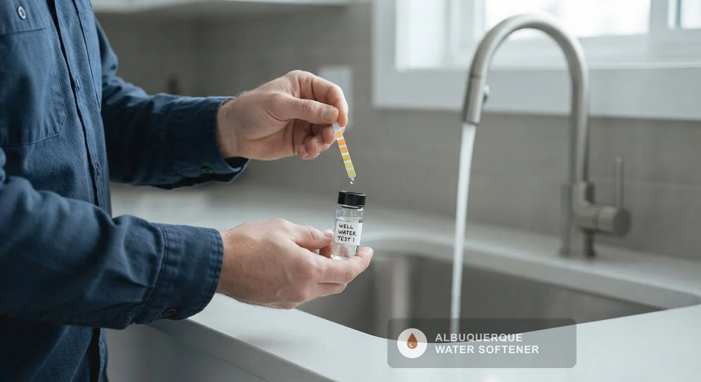

<a class="btn btn-primary" style="color:#ffffff;" href="/#estimate">Request a Free Estimate</a><a class="btn" style="background:var(--color-primary);color:#ffffff;" href="/contact/">Call for Service</a>

## What Water Treatment Services Are Available in Albuquerque, NM?

Water treatment starts with testing and covers filtration, well water treatment, contaminant removal, reverse osmosis, UV purification and drinking water systems.

### Why Test Before You Treat

A water test tells you which problem you have before you pay to solve it. ABCWUA's 2025 water quality report says it collects and tests more than 5,500 water samples a year from wells, storage tanks, customer taps and its surface-water treatment plant, so taste, scale, iron or a private well decide what a household needs on top of that.

### Water Quality Testing

[Water Quality Testing in Albuquerque, NM](/water-quality-testing/) measures hardness, iron, pH, total dissolved solids and chlorine at your tap, and sends samples to a lab for bacteria and metals. It is the first step of every recommendation.

### Water Filtration System Installation

[Water Filtration System Installation in Albuquerque, NM](/water-filtration-systems/) treats water where it enters the home, with sediment and carbon stages that reduce particles, chlorine taste and odor at every tap.

### Well Water Softener and Treatment

[Well Water Softener and Treatment in Albuquerque, NM](/well-water-softener-albuquerque-nm/) handles private wells, which draw directly from an aquifer and can carry hardness, iron, sulfur or bacteria that city water does not.

### Water Contaminant Removal

[Water Contaminant Removal in Albuquerque, NM](/water-contaminant-removal-albuquerque-nm/) targets a specific result from a test, such as lead, nitrate, arsenic or chlorine byproducts, with the filter type that removes it.

### Reverse Osmosis System Installation

[Reverse Osmosis System Installation in Albuquerque, NM](/reverse-osmosis-installation/) puts a membrane filter under the kitchen sink for drinking and cooking water, removing most dissolved minerals and many contaminants at one tap.

### UV Water Purification System Installation

[UV Water Purification System Installation in Albuquerque, NM](/uv-water-purification/) uses ultraviolet light to inactivate bacteria and viruses without chemicals, which suits private wells and homes with a bacteria result.

### Drinking Water System Installation

[Drinking Water System Installation in Albuquerque, NM](/drinking-water-systems/) covers under-sink filters, reverse osmosis and remineralizing stages for the tap you drink from.

### How to Choose a Water Treatment Service

If your test shows hardness above 10.5 grains per gallon, a softener treats it, and the [Water Softener Systems in Albuquerque, NM](/water-softener-systems/) hub covers that side. If it shows a taste, odor, iron or contaminant result, filtration or reverse osmosis treats it.

| Service | Treats | Where it installs | Best for |
|---|---|---|---|
| Whole house filtration | Sediment, chlorine taste, odor | Main water line | Every tap, taste and particles |
| Reverse osmosis | Dissolved minerals, many contaminants | Under one sink | Drinking and cooking water |
| UV purification | Bacteria and viruses | Main line or one tap | Private wells, bacteria results |
| Water softener | Calcium and magnesium | Main water line | Hardness above 10.5 gpg |

EPA secondary standards give the benchmark numbers a test is read against: total dissolved solids 500 mg/L, iron 0.3 mg/L, and pH 6.5 to 8.5.

> **Not a good fit if...** you want to buy a filter before testing. A filter that treats a problem you do not have adds cost and replacement parts without improving your water.

### Get Your Free Estimate

Request a free estimate or call to start with a water test. The estimate is itemized, so you see each system and each labor line before you approve anything.

## What Decides Which Water Treatment Service Fits an Albuquerque Home?

Your test result decides the service: hardness points to a softener, taste and odor point to carbon filtration, and a bacteria or iron result on a private well points to well treatment or UV. A test at your tap takes minutes and replaces guessing.

## Frequently Asked Questions About Water Treatment

Do I need a filter if I have a water softener?

A softener and a filter solve different problems, so many homes use both. A softener removes calcium and magnesium, and a carbon filter reduces chlorine taste and odor. ABCWUA's 2023 distribution monitoring measured free chlorine at a city average of 0.9 mg/L, so a carbon stage is the usual choice for households that notice chlorine.

Does reverse osmosis remove hardness?

Reverse osmosis removes most dissolved minerals at one tap, but it is built for drinking water, not for protecting a whole house. Hard water shortens a membrane's life, so a softener ahead of the system helps it last.

How often does a private well need testing?

EPA recommends that private well owners test for bacteria every year and test for other contaminants when a risk is present. Nobody tests a private well for you, so the owner schedules it.

Does Albuquerque city water need UV treatment?

City water from ABCWUA is already disinfected, so UV is mainly for private wells and for homes with a bacteria result on a test. A test shows whether a household needs it.

[Albuquerque Elite Water Softener NM](/) provides water treatment services for homes and businesses across Albuquerque and Bernalillo County.

