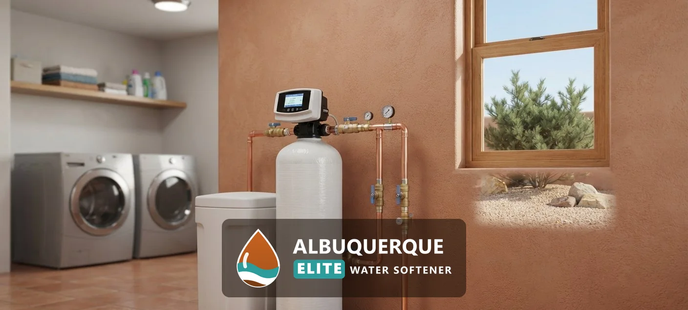

<a class="btn btn-primary" style="color:#ffffff;" href="/#estimate">Request a Free Estimate</a><a class="btn" style="background:var(--color-primary);color:#ffffff;" href="/contact/">Call for Service</a>

## What Does Well Water Treatment Involve in Albuquerque, NM?

Well water treatment covers four systems: a well water softener, an iron filter, a hydrogen sulfide filter and a well water sediment filter.

### Well Water Softener Installation

A well water softener installs after the pressure tank so it treats all water entering the house. The unit is sized to your household's water use and the hardness of your well, and it needs clean water to work properly. Iron, sulfur and sediment must be handled first or alongside it, because they foul the resin.

### Iron Filter Installation

An iron filter removes dissolved iron that causes orange or rust stains on fixtures and laundry, and a metallic taste. It oxidizes the iron and filters it out before the water reaches the softener. Removing iron protects the softener's resin and extends its life.

### Hydrogen Sulfide Filter

Hydrogen sulfide gives water a rotten-egg smell. A hydrogen sulfide filter uses an oxidizing media or carbon to remove the gas and the odor. A test confirms that sulfur is the cause before we install one.

### Well Water Sediment Filter

A sediment filter catches sand, silt and rust particles that cloud well water and clog equipment. It installs at the start of the treatment line and protects every stage behind it.

### Why Well Water in the Albuquerque Area Needs Special Treatment

Private wells draw directly from an aquifer, and ABCWUA itself pumps groundwater for part of its supply. City water is different: ABCWUA treats and tests it before it reaches homes, with more than 5,500 samples tested a year. Well water is not. Hardness, iron, sulfur and other minerals occur naturally in groundwater, and each well differs, so a test is the only reliable guide.

### Well Water Testing

A well [water test](/water-quality-testing/) is the first step of every well job. Well-water guidance recommends that private well owners test for bacteria every year, and for nitrate, arsenic and other substances on a schedule that depends on local conditions, because no utility does it for you. EPA secondary standards give the benchmarks a well test is read against: iron 0.3 mg/L, total dissolved solids 500 mg/L and pH 6.5 to 8.5, and hardness above 180 mg/L is very hard on the USGS scale. We test for hardness, iron, sulfur, pH, sediment and more, and we can arrange lab tests for bacteria and [contaminants](/water-contaminant-removal-albuquerque-nm/). Ask which tests are free and which are billed.

> **Not a good fit if...** your well has bacterial contamination. A softener will not fix that, and disinfection or UV treatment must come first.

## What does a well need treated first?

Treat contamination first, then iron, sulfur and sediment, and soften last. That order protects the softener and gives you the best result for the money.

Homeowners comparing options also read about [UV water purification](/uv-water-purification/), [whole-house water filtration](/water-filtration-systems/), [water softener installation](/water-softener-installation/), [the hard water guide](/water-softener-guides/hard-water-albuquerque-nm/) and [how to size a water softener](/water-softener-guides/water-softener-size-guide/).

## Frequently Asked Questions

Can a water softener remove iron from well water?

A softener removes small amounts of dissolved iron, but heavier iron needs an iron filter first or it fouls the resin.

How do I know if my well water is safe?

Only a test shows. Guidance recommends testing for bacteria every year, with nitrate and other substances on a schedule that depends on local conditions.

Why does my well water smell like rotten eggs?

That smell usually comes from hydrogen sulfide gas. A test confirms it, and an oxidizing filter removes it.

Do I need a softener and a filter for a well?

Most wells need both. Filters handle iron, sulfur and sediment, and the softener handles hardness.

What does well water treatment cost in Albuquerque?

Iron content and flow rate decide the system, so your test results set the price. The estimate is free and itemized.

[Albuquerque Elite Water Softener NM](/) provides well water softener and treatment for homes and businesses across Albuquerque and Bernalillo County.

## Get Your Free Estimate

Request a free well water treatment estimate. We will contact you to confirm a time. [Get a Free Estimate](#estimate) or return to Albuquerque Elite Water Softener for every service we offer.
